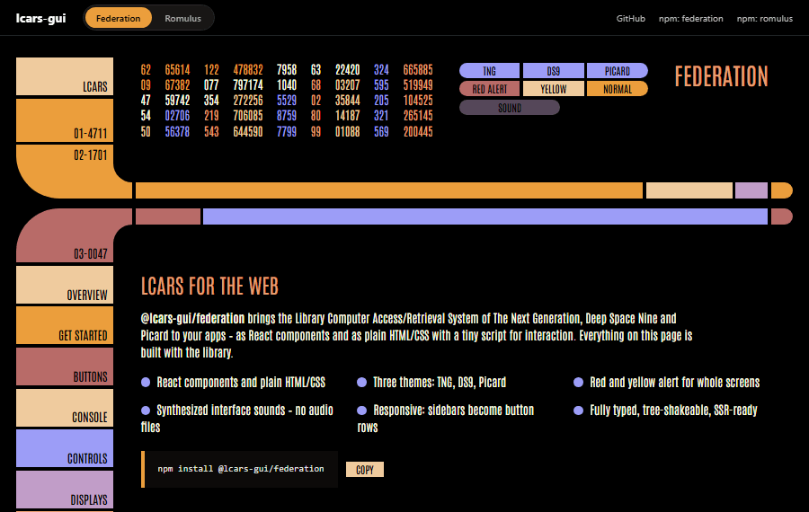
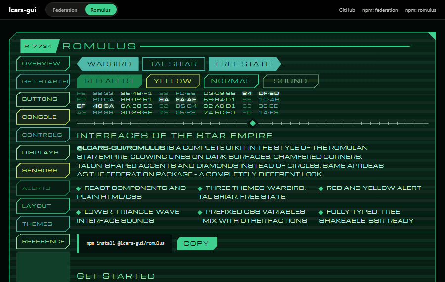

# lcars-gui

Star Trek UI components for **React** and **plain HTML/CSS/JS** – one library per faction,
each with its own design, themes and interface sounds.

**[▶ Live demo & docs](https://aarondnas.github.io/lcars-gui/)**

| Federation (LCARS) | Romulus |
|---|---|
| [](https://aarondnas.github.io/lcars-gui/#federation) | [](https://aarondnas.github.io/lcars-gui/#romulus) |
| `npm install @lcars-gui/federation` | `npm install @lcars-gui/romulus` |
| Themes: TNG, DS9, Picard | Themes: Warbird, Tal Shiar, Free State |

## Packages

| Package | Contents |
|---|---|
| [`@lcars-gui/federation`](packages/federation) | LCARS: elbows, capsule buttons, data cascade, keypad, sensors … |
| [`@lcars-gui/romulus`](packages/romulus) | Romulan: chamfered corners, glowing lines, diamonds, radar sweep … |
| [`@lcars-gui/core`](packages/core) | Shared foundation: sound engine, HTML/JS behavior, CSS build |

Planned: `cardassia`, `qonos`.

## Quick start

```tsx
// React
import "@lcars-gui/federation/ui.css";
import { Frame, Button, LcarsRoot } from "@lcars-gui/federation/react";
```

```html
<!-- Plain HTML/JS -->
<link rel="stylesheet" href="https://unpkg.com/@lcars-gui/federation/dist/ui.css">
<script src="https://unpkg.com/@lcars-gui/federation/dist/index.global.js"></script>
<script>LcarsFederation.initLcars({ sound: true });</script>
```

See the package READMEs and the [live docs](https://aarondnas.github.io/lcars-gui/) for details.

## Development

```sh
npm install
npm run build        # build all packages
npm run dev          # start the Next.js example
npm run typecheck
npm run previews     # re-record docs/*.gif (needs Edge or Chrome)
```

The demo site lives in [`apps/examples/web`](apps/examples/web) and is deployed to GitHub Pages
by GitHub Actions on every push to `main`.

## License

[MIT](LICENSE). Star Trek and LCARS are trademarks of CBS Studios / Paramount; this is an unofficial fan project.
The bundled font Aaron Compressed is part of this project and also MIT licensed.
